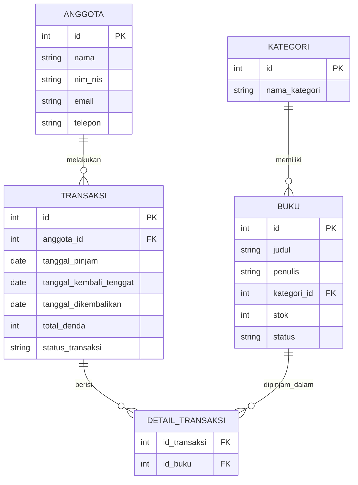
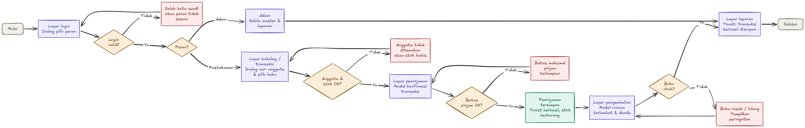

# ShelfSystem

**Sistem Manajemen Perpustakaan Modern & Aksesibel**

> Project Brief v1 · Pelatihan Pengembangan Web dengan Node.js dan React (Karirjitu Indonesia × BBPVP Bekasi)
> Disusun oleh **Talitha Nabila**

---

## Masalah

Pencatatan peminjaman dan pengembalian buku secara manual sering menyebabkan ketidakcocokan stok, keterlambatan pengembalian yang sulit dipantau, serta rekapitulasi denda yang tidak efisien.

## Pengguna & Perannya

| Peran | Tanggung jawab |
|---|---|
| **Admin** | Mengelola data master (buku, kategori, anggota) dan melihat laporan rekapitulasi. |
| **Pustakawan / Petugas** | Melayani transaksi peminjaman, pengembalian, dan pencatatan denda. |

## Fitur MVP

1. **Autentikasi Login Switcher 2 Peran** (Admin & Pustakawan)
2. **Manajemen Data Master** Buku, Kategori, dan Anggota
3. **Form Transaksi Peminjaman Multi-Buku**
4. **Form Pengembalian & Kalkulasi Denda Otomatis**
5. **Dashboard Ringkasan & Laporan Rekapitulasi Transaksi**

## Proses Bisnis Utama

Pustakawan mendaftarkan transaksi peminjaman buku untuk anggota (stok berkurang). Saat pengembalian, sistem otomatis mengecek tenggat waktu, menghitung denda keterlambatan (jika ada), dan mengembalikan stok buku.

- **Peminjaman:** pembuatan transaksi baru otomatis mengurangi stok buku terkait. Satu transaksi dapat mencakup lebih dari satu buku.
- **Pengembalian & denda:** selisih hari dari tenggat dicek otomatis. Jika terlambat, denda dihitung otomatis (contoh: Rp1.000/hari) dan stok buku dipulihkan.

## Data Utama

| Entitas | Atribut |
|---|---|
| **Buku** | id, judul, penulis, kategori_id, stok, status |
| **Kategori** | id, nama_kategori |
| **Anggota** | id, nama, nim_nis, email, telepon |
| **Transaksi** | id, anggota_id, tanggal_pinjam, tanggal_kembali_tenggat, tanggal_dikembalikan, total_denda, status_transaksi |
| **Detail Transaksi** | id_transaksi, id_buku *(relasi banyak-ke-banyak antara Transaksi dan Buku)* |

### Relasi antar data



## User Flow

Alur utama: login → pilih peran → cari anggota & pilih buku → konfirmasi peminjaman → pengembalian & denda → laporan. Setiap langkah memiliki jalur gagal.

| Langkah | Layar | Dialog yang muncul | Jalur gagal |
|---|---|---|---|
| 1 | Layar Login | Dialog / modal pilihan peran (Admin / Pustakawan) | Salah kata sandi / peran tidak sesuai |
| 2 | Layar Katalog / Transaksi | Dialog pencarian anggota & pemilihan buku | Anggota tidak ditemukan / stok habis |
| 3 | Layar Peminjaman | Modal konfirmasi transaksi peminjaman | Batas maksimal pinjam terlampaui |
| 4 | Layar Pengembalian | Modal rincian keterlambatan & kalkulasi denda | Buku rusak / hilang |
| 5 | Layar Laporan | Toast notifikasi transaksi berhasil disimpan | — |



## Desain & Aksesibilitas

Desain dirancang dengan prinsip aksesibilitas tinggi (WCAG, ramah pengguna dengan keterbatasan penglihatan / buta warna) dan dibuat di Google Stitch sebagai pedoman visual.

- Palet kontras tinggi: Deep Slate Blue `#1E3A8A` (utama), Dark Teal `#0D9488` (tombol aksi), Forest Green `#15803D` (status tersedia), Deep Crimson `#B91C1C` (status denda / terlambat).
- Informasi status (Tersedia, Sedang Dipinjam, Terlambat) **tidak hanya mengandalkan warna**, tetapi disertai ikon dan teks label yang kontras.
- Teks minimal 16px dengan kontras yang tajam.

**Ringkasan DESIGN.md**

| Token | Nilai | Variabel CSS |
|---|---|---|
| Warna utama | Deep Slate Blue `#1E3A8A` | `--warna-utama` |
| Warna teks | Slate Gray `#0F172A` | `--warna-teks` |
| Font judul | Plus Jakarta Sans | `--font-judul` |
| Font isi | Inter | `--font-isi` |
| Jarak dasar | 16px (1rem) | `--jarak` |
| Sudut (radius) | 8px (0.5rem) | `--sudut` |

## Kesesuaian dengan Syarat Proyek Portofolio

- [x] Tampilan web: beberapa layar + form
- [x] Minimal 4 data utama yang saling terhubung
- [x] Ada hubungan banyak-ke-banyak (Transaksi ↔ Buku)
- [x] 1 proses bisnis multi-langkah (peminjaman → pengembalian → denda)
- [x] Login dengan 2 peran (Admin & Pustakawan)
- [x] Ada "jenis" sesuatu (status ketersediaan buku, status transaksi)
- [x] Laporan / ringkasan

## Struktur Repositori

```text
shelfsystem-library/
├── README.md
├── .gitignore
└── docs/
    ├── setup.png
    └── ui/
        ├── user-flow.png
        ├── sketsa-*.jpg
        ├── stitch-*.png
        └── DESIGN.md
```

## Teknologi

Dikembangkan bertahap selama pelatihan dengan **HTML, CSS, JavaScript**, kemudian **Node.js** dan **React**. Kontrol versi menggunakan **Git** dan **GitHub**.

## Status

- [x] Project Brief v1
- [x] Repositori GitHub
- [ ] Mock-up HTML & CSS (Hari 2)
- [ ] Implementasi lanjutan